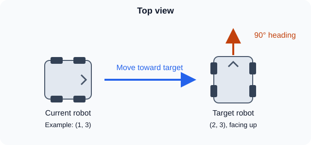

# Autopilot

Calculates movement toward a target pose.

## 1. Constraints

Set the movement limits to help keep the robot balanced.

```kotlin
// Speed (m/s), acceleration (m/s²), jerk (m/s³)
val constraints = APConstraints(3.0, 5.0, 2.0)
```

## 2. Profile

Like checking if a PID is near its target, set the allowed position and heading errors.

```kotlin
val profile = APProfile(constraints)
    .withErrorXY(2.cm)
    .withErrorTheta(1.deg)

val autopilot = Autopilot(profile)
```

## 3. Target

Give `APTarget` the position and heading you want to reach.

```kotlin
// x, y in meters; heading in degrees
val target = APTarget(Pose2d(2.0, 3.0, Rotation2d.fromDegrees(90.0)))
```



## 4. Calculate

Give it the current pose, robot-relative velocity, and target to get the movement needed.

```kotlin
val result = autopilot.calculate(drive.pose, drive.chassisSpeeds, target)
```

- [vx](../../subsystems/drive/README.md#chassis-velocity), [vy](../../subsystems/drive/README.md#chassis-velocity): movement speeds (`result.vx`, `result.vy`).
- `result.targetAngle`: desired heading, not turning speed !!

* for turning speed ([omega](../../subsystems/drive/README.md#chassis-velocity)) we need to implement using normal pid controller.

## 5. Ending

Checks if the position and heading are within the profile's allowed errors.
```kotlin
val finished = autopilot.atTarget(drive.pose, target)
```
To end the driving you need to use the finish condition and [stop](../../subsystems/drive/README.md#stopping) the drive.
