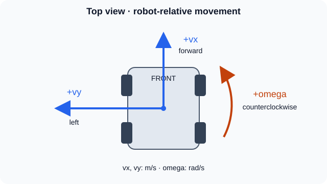
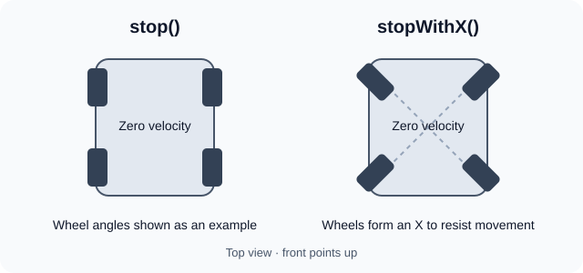

# Drive

The drive system controls the robot's movement using four swerve modules. Each
module can turn and drive independently, so the robot can move in any direction
while rotating.

## Robot pose

The pose is the robot's position and heading on the field. It is estimated using
the wheels, gyro, and vision measurements.

```kotlin
val pose = drive.pose
val x = pose.x // meters x
val y = pose.y // meters y
val heading = pose.rotation // Rotation2d
```

## Chassis velocity



`ChassisVelocities(vx, vy, omega)` describes the movement of the whole robot:

| Value   | Meaning                                                    | Unit               |
|---------|------------------------------------------------------------|--------------------|
| `vx`    | Forward/backward speed                                     | meters per second  |
| `vy`    | Sideways speed, positive to the left                       | meters per second  |
| `omega` | Turning speed, positive counterclockwise viewed from above | radians per second |

`omega` is how fast the robot turns, not its heading. For example, `Math.PI`
means turning 180 degrees per second.

`runVelocity` expects robot velocities: forward and left and rotational (velocity x , velocity y , velocity rad/s) are relative
to the robot's current heading.

```kotlin
import org.wpilib.math.kinematics.ChassisVelocities

drive.runVelocity(ChassisVelocities(1.0, 0.0, 0.0)) // forward at 1 m/s
drive.runVelocity(ChassisVelocities(0.0, 0.0, 1.0)) // turn at 1 rad/s
```

These are separate examples. Call `runVelocity` each cycle while a drive command
is running. The drive converts the requested velocity into a speed and steering
angle for each module, limiting wheel speeds to the maximum supported speed.

To read the measured robot-relative velocity:

```kotlin
val velocity = drive.chassisSpeeds
```

## Driver control

`DriveCommands.joystickDrive(...)` handles normal driving. It uses field-relative
movement, so the translation direction stays relative to the field as the robot
turns. It applies joystick deadband, squares inputs for finer control, and scales
them to the drive's maximum speeds.

## Stopping



```kotlin
drive.stop() // request zero velocity
drive.stopWithX() // stop and point the wheels into an X to resist movement
```

## Main files

- `Drive.java`: controls the modules, updates odometry, and provides pose and velocity.
- `DriveCommands.java`: driver control and drive commands.
- `TunerConstants.java`: hardware configuration, module positions, and tuning values.
- `ModuleIOs/`: module control and hardware/simulation implementations.
- `gyroIOs/`: gyro readings and hardware/simulation implementations.
